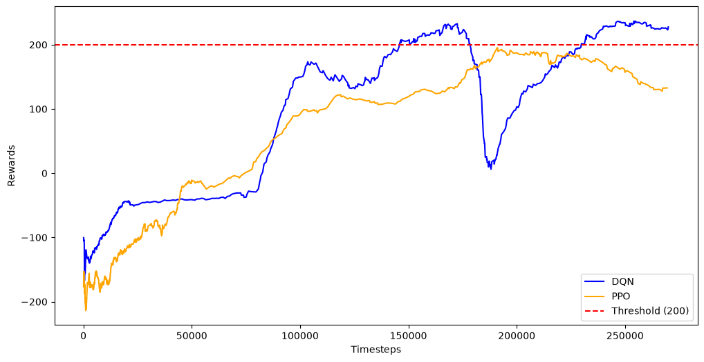

Lunar Rocket Landing: DQN vs. PPO

An end-to-end Reinforcement Learning (RL) project studying and comparing the behavioral dynamics of **Deep Q-Networks (DQN)** and **Proximal Policy Optimization (PPO)** on the `LunarLander-v3` environment.

---

## Project Overview
The goal of this project is to analyze how value-based off-policy algorithms (DQN) compare against policy-gradient on-policy algorithms (PPO) when controlling a lunar lander's thrust and orientation engines to achieve a safe, fuel-efficient landing between designated target flags.

* **Environment:** `LunarLander-v3` (via [Gymnasium](https://gymnasium.farama.org/environments/box2d/lunar_lander/))
* **Frameworks:** `Stable-Baselines3`, `PyTorch`, `OpenCV`
* **Inspiration & Reference:** Open-source benchmark setup adapted from [juliankappler/lunar-lander](https://github.com/juliankappler/lunar-lander)

---

## Algorithm Comparison & Behavioral Dynamics

### 1. Deep Q-Network (DQN)
* **Type:** Off-Policy / Value-Based
* **Mechanism:** Estimates the optimal action-value function $Q(s, a)$ using a neural network. It stores state-action transitions in a **Replay Buffer** to sample mini-batches during training and uses an $\epsilon$-greedy schedule for exploration.
* **Landing Behavior:** Highly sample-efficient in early stages. It makes rapid, discrete thruster adjustments but exhibits temporal performance variance due to Q-value overestimation shifts.

### 2. Proximal Policy Optimization (PPO)
* **Type:** On-Policy / Policy-Gradient (Actor-Critic)
* **Mechanism:** Directly optimizes action selection probabilities $\pi_\theta(a\vert{}s)$ using an **Actor** (policy network) and a **Critic** (value estimator network). It applies a **clipped surrogate objective** to prevent destructive policy updates.
* **Landing Behavior:** Learns smooth, stable thruster throttling. It avoids drastic performance crashes during training, yielding steady convergence toward the target solved threshold (+200 reward).

---

## Algorithm Comparison Summary

| Feature | Deep Q-Network (DQN) | Proximal Policy Optimization (PPO) |
| :--- | :--- | :--- |
| **Category** | Value-Based (Off-Policy) | Actor-Critic (On-Policy) |
| **Memory Mechanics** | Replay Buffer | Trajectory Rollout Buffers |
| **Action Selection** | $\epsilon$-greedy exploration ($\arg\max_a Q(s,a)$) | Stochastic distribution $\pi(a\Vert{}s)$ |
| **Landing Behavior** | Rapid, discrete button taps | Smooth, soft thruster adjustments |

---

Reinforcement Learning Feedback Loop

 

### 1. State Vector ($S_t$ - 8 Variables)
At every step, the lander receives an 8-dimensional continuous state vector:
- **Positions:** Horizontal position ($x$), Vertical position ($y$)
- **Velocities:** Horizontal velocity ($v_x$), Vertical velocity ($v_y$)
- **Orientation:** Lander angle ($\theta$), Angular velocity ($\omega$)
- **Leg Contacts:** Left leg grounded ($0$ or $1$), Right leg grounded ($0$ or $1$)

### 2. Action Space ($A_t$ - 4 Discrete Controls)
- `0`: Do Nothing
- `1`: Fire Left Engine
- `2`: Fire Main Engine
- `3`: Fire Right Engine

### 3. Reward Structure ($R_t$)
- **Positioning:** Bonus points for moving closer to the center landing pad.
- **Thruster Costs:** Fuel penalties for main engine ($-0.3$/frame) and side engines ($-0.03$/frame).
- **Leg Contact:** $+10$ points for each leg touching the ground.
- **Terminal States:** $+100$ bonus for landing safely; $-100$ penalty for crashing.

---

## Training Performance & Learning Curve



### Performance Key Insights:
* **Deep Q-Network (DQN - Off-Policy):**
  * **Sample Efficiency:** Reaches the solved threshold (+200 average reward) faster than PPO, hitting high peaks around ~160k and ~240k timesteps[cite: 2].
  * **Policy Instability:** Displays classic value-based volatility, including a sharp score drop near 180k timesteps due to replay buffer shifts/target network synchronization before recovering[cite: 2].
* **Proximal Policy Optimization (PPO - On-Policy):**
  * **Smooth Convergence:** Demonstrates low-variance, steady reward progression up toward ~195 score near 190k timesteps[cite: 2].
  * **Stability:** Avoids the drastic policy crashes seen in DQN due to its clipped surrogate loss objective[cite: 2].

---
Repository Structure

## 📁 Repository Structure

```text
.
├── Training/
│   └── logs/
│       ├── Training_DQN/
│       │   └── monitor.csv
│       └── Training_PPO/
│           └── monitor.csv
├── model_weight/
│   ├── dqn_lunarlander.zip
│   └── ppo_lunarlander.zip
├── 1_train_dqn.ipynb
├── 2_train_ppo.ipynb
├── 3_compare_models.ipynb
├── watch_lander.py
├── dqn_vs_ppo_comparison.png
├── landing_comparison.mp4
└── README.md
---

